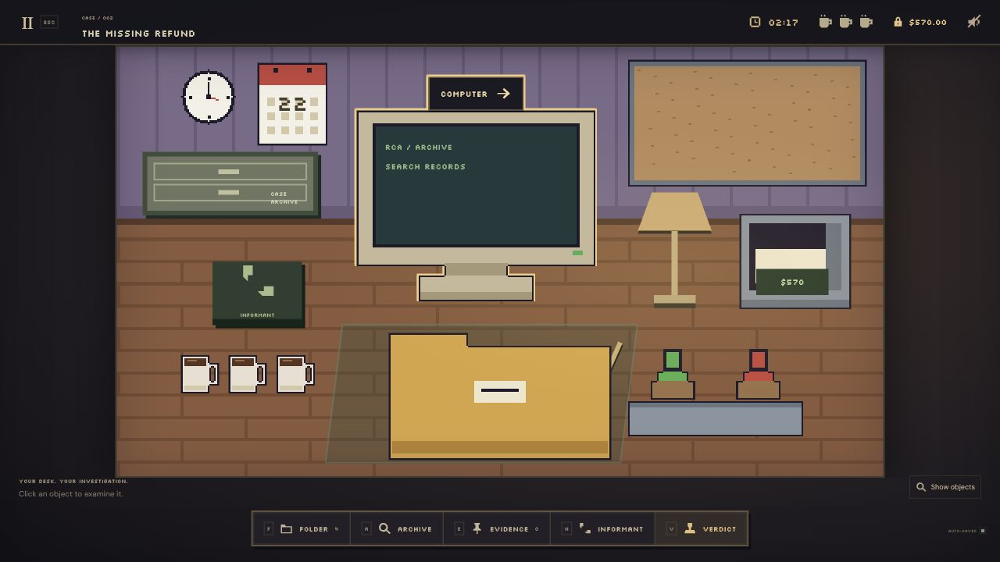
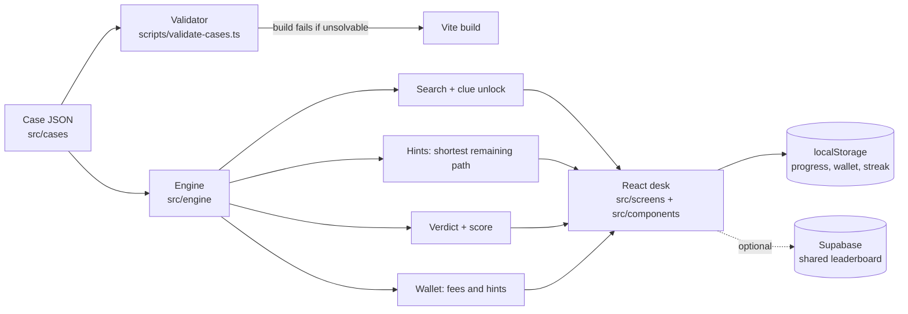

# Case Desk

**A pixel detective game where everyday paperwork hides the crime.**
Business Cup 2.0 · Entertainment track · Team **GreedX**

- ▶ **Play:** `LIVE_URL` — any modern browser, no sign-up, no install, no payment
- 📊 **Pitch deck:** 10-slide PDF in the submission
- 💻 **Code:** https://github.com/SungatSerikov/hackathon-zimran



## TL;DR

- **What:** you run the complaints desk of a small-town US consumer bureau. Read invoices, bank statements and chats, search the clues on an in-game computer, pin evidence and stamp the company **GUILTY** or **NOT GUILTY**.
- **For whom:** US adults 25–45 who love mysteries and puzzles and have 5–15 free minutes.
- **Why it matters:** short breaks feel wasted, and Americans lost **$12.5B to fraud in 2024** (FTC). The game is fun first and quietly trains the instincts that protect real money.
- **Business:** free to start; **Detective Pass $4.99/month** for the case archive, weekly cases and unlimited hints. ≈1.7M subscribers = $100M ARR.
- **Built in 24 hours:** 2 complete cases, a real search engine, a case validator, an in-game economy, **225 automated tests**.

---

## How Case Desk meets the judging criteria

| Criterion | Weight | Our evidence | Check it |
| --- | --- | --- | --- |
| **Does it work?** Product & engineering | 40% | Live web app, both cases playable end-to-end with no login. Core logic is real: fair clue search, a validator that proves every case is solvable, scoring, wallet. 225 tests, typed React + TypeScript. | [Try it in 2 minutes](#try-it-in-2-minutes) · [Engineering](#engineering) · `npm test` |
| **What do we sell?** Value & retention | 20% | Case fees fill a safe, score + leaderboard per case, daily streak, paid informant hints, new cases on a schedule. | [Why players come back](#why-players-come-back) |
| **Who do we sell to?** Problem & user | 15% | One user (US mystery/puzzle fans, 25–45) and one pain (wasted downtime), with a real-money angle (everyday scams). | [Problem and user](#problem-and-user) |
| **Why does it make money?** Business potential | 15% | Freemium subscription, web-first (no app-store fee), $100M ARR math, LTV ≈ 4× CAC (assumptions stated). | [Business model](#business-model) |
| **Is it new?** Originality | 10% | Detective story + fair search engine + real-life money instincts in 10-minute browser sessions. | [What makes it new](#what-makes-it-new) |

Pass/fail: **B2C** ✅ · **web only** ✅ · **deck + live link + public repo** ✅

---

## Try it in 2 minutes

Use **EN / РУ** in the menu, desk HUD or case results to switch between English and Russian. The interface, both cases, documents, tutorial, hints and verdicts are translated. Your language preference is saved locally; switching keeps the timer, selected answer and evidence.

| # | Do this | You should see |
| --- | --- | --- |
| 1 | Open the live link → **Case files** → **The Double Charge** (tutorial) | A pixel office desk; a client arrives with a claim |
| 2 | Click the **folder**, open the invoice and the bank statement | Two $480 charges from **different merchants** |
| 3 | Click the **computer**, search `FXR Services LLC` | A business-registry record unlocks |
| 4 | Pin two documents to the **cork board** | The evidence counter goes up |
| 5 | Click the **stamps** → **GUILTY**, pick the culprit, the method and the two pinned documents | Verdict, score breakdown, a fee paid into the **safe** |

Then play **The Missing Refund** (~12 min): a lookalike “support” site, a return label to a warehouse, and a twist — the store is **NOT GUILTY**.

Also try: searching a name you have not seen yet (nothing unlocks — the search is fair), a wrong accusation (−1 coffee mug, +60 s), the **informant phone** (paid hint), the **SOUND** button (background jazz). Spoiler walkthroughs: [`docs/CASE_WALKTHROUGHS.md`](docs/CASE_WALKTHROUGHS.md).

---

## Problem and user

**Pain 1 — wasted downtime.** Busy adults with jobs, kids and bills scroll through short breaks and come out with nothing: no challenge, no feeling of being sharper.

**Pain 2 — everyday money traps.** US consumers reported losing **$12.5 billion to fraud in 2024**, up 25% in a year; 38% of people who reported fraud lost money; email was the #1 contact method *(FTC Consumer Sentinel Network, March 2025)*. Double charges, fake invoices and lookalike support sites are exactly the paperwork people don’t check.

**User.** US adults 25–45 who already play daily word games, watch detective shows or listen to true-crime podcasts, with 5–15 minutes at lunch, on a commute or after the kids’ bedtime.

**Job to be done:** *“Give me a short, smart break that makes me feel clever — and harder to fool.”*

---

## The product

Every prop on the desk is a working tool.

| Desk object | What it does |
| --- | --- |
| 🖥 Computer | Records search: type names, phones, addresses, order numbers, or click highlighted clues |
| 📁 Folder | The case file — 8 document types: receipt, contract, chat, email, ad, bank statement, note, record |
| 📌 Cork board | Pinned evidence |
| ⏱ Clock · 📅 Calendar | Investigation timer · in-world date (to check deadlines) and play streak |
| ☕ Coffee ×3 | Lives: each wrong conclusion costs one mug and +60 s |
| 💰 Safe | Your bureau cash: fees for solved cases |
| ☎ Phone | Paid informant hints |
| 🗄 Cabinet | Premium case archive (subscription preview) |
| 🔴🟢 Stamps | The verdict on the company named in the claim: **GUILTY / NOT GUILTY** |

A correct verdict needs **all four parts** — the stamp, the responsible person, the method (out of 3–4 plausible versions) and **two pinned supporting documents** — so guessing does not win.

**Shipped content:** *The Double Charge* (tutorial · 6 documents · 3 characters) and *The Missing Refund* (14 documents · 5 characters · false leads). Desktop and phones (375 px+), keyboard shortcuts (**F A E H V**, **Esc**), fullscreen, reduced motion.

---

## Why players come back

| Mechanic | Status | Effect |
| --- | --- | --- |
| Case fees into the safe: +50% for speed, +$50 for no mistakes, 25% on replays | ✅ live | Visible progress, reason to replay faster |
| Score, best scores and a leaderboard per case | ✅ live (shared board via optional Supabase) | Competition |
| Daily play streak on the desk calendar | ✅ live | Habit |
| Informant hints for in-game cash ($40, two levels) | ✅ live | Natural path to the paid tier |
| New cases on a schedule: weekly, then a daily mini-case | 🗺 next, powered by the case pipeline | A reason to open it tomorrow |
| Detective duels: send a case to a friend and race their replay | 🗺 next (interest button live) | Viral and social loop |

---

## Business model

| Tier | Price | Includes |
| --- | --- | --- |
| Free | $0 | Tutorial + current case, $100 starting cash, leaderboard |
| **Detective Pass** | **$4.99 / month** | Full archive, weekly cases, unlimited hints, private leagues, author debriefs |
| Bureau cash pack | $1.99 one-off | $500 in-game cash for hints |

- **Web-first:** Stripe payments, no 15–30% app-store fee.
- **Demand exists:** mobile puzzle games earned ≈**$10B** in in-app revenue worldwide in 2025, +14% YoY *(Naavik)*; **6.5M+** NYT subscribers pay for a bundle that includes Games *(NYT Co., Q4 2025)*.
- **$100M ARR:** $59.88 per subscriber per year → **≈1.7M subscribers**, about a quarter of the NYT bundle base.
- **Unit economics (our planning assumptions):** LTV ≈ $39 ($4.85 net/month × ~8 months); CAC target ≤ $10 via shareable cases, duel invites and short “solve this case” videos → **LTV/CAC ≈ 4×**.
- **Cheap content:** cases are JSON graphs checked by our validator, so an LLM drafts, the validator rejects broken cases, an editor polishes — hours per case, not weeks.

---

## What makes it new

| Alternative | Gets right | Missing |
| --- | --- | --- |
| Daily puzzle apps | Short, habit-forming | No story, no real-life payoff |
| Mystery subscription boxes | Deep detective story | Physical, slow, one case a month |
| Detective PC games with database search | Investigation feel | One-time purchase, then over |
| Scam-awareness trainings | Real-life skill | Boring, corporate |
| **Case Desk** | **10-minute story + real-life instinct** | **Browser-based, ongoing cases, competitive** |

Inspired by the genre of desk and document-inspection games; all art, characters, cases, UI and code are our own.

---

## Engineering

**Stack:** React 19 · TypeScript · Vite 7 · Tailwind 4 · Vitest · optional Supabase (REST + RLS) · Vercel static hosting. Pixel art is produced by our own dependency-free Node scripts in `tools/`.



| Module | Responsibility |
| --- | --- |
| `src/engine/search.ts`, `normalize.ts`, `clues.ts` | Fair search: normalized queries (phones by digits, order numbers by alphanumerics), 1-character typo tolerance; an entry unlocks only after its key appears in a document the player has seen |
| `src/engine/validate.ts` + `scripts/validate-cases.ts` | Case as a graph: schema, IDs, dates, solvability, ≥80% reachable documents, shortest query path (2 searches tutorial, 3 main). Build fails on an unsolvable case |
| `src/engine/hint.ts` | Next step of the shortest remaining path: first clue type + source document, then the exact query |
| `src/engine/verdict.ts`, `score.ts` | 4-part verdict check; `score = max(0, 1000 − seconds − 150·wrong − 5·extraSearches − 50·hints)` |
| `src/engine/wallet.ts` | Fees `100·difficulty` + speed/clean bonuses, replays 25%, idempotent per run ID |
| `src/store/`, `src/lib/` | Run reducer and attempt protection; safe storage, streak, records service, audio and music |
| `src/i18n/`, `src/cases/localized.ts` | Persistent EN/RU interface and case content; bilingual aliases reuse prior searches without an extra charge |
| `src/components/`, `src/screens/` | Desk scene, records computer, document renderer, dialogs; menu, desk, results |
| `src/scene/layout.json`, `sprite-meta.json` | Desk hotspots and overlay zones, editable without code |

<details>
<summary><b>Run locally, deploy, art and case workflow</b></summary>

Requires **Node.js 22.12+**.

```bash
npm ci
npm run dev        # play locally
npm test           # 225 tests
npm run validate   # case schema, reachability, shortest paths
npm run build      # validate + TypeScript + production build
npm run preview    # preview the production build
```

- **No environment variables** are needed to play. Optional shared leaderboard: run `supabase/schema.sql` in Supabase, copy `.env.example` to `.env.local`, set `VITE_SUPABASE_URL` and the **public anon key** (never a service-role key).
- **Deploy:** import into Vercel (framework Vite, build `npm run build`, output `dist`; `vercel.json` included). Disable deployment protection so the link opens without login.
- **Art:** replace PNGs in `public/assets/` keeping names and sizes; move hotspots in `src/scene/layout.json`; preview with `npm run scene:preview`. Contract: [`ASSETS.md`](ASSETS.md), prompts: [`ASSET_PROMPTS.md`](ASSET_PROMPTS.md).
- **Translations:** Russian copies live in `src/cases/ru/`. Keep IDs, numbers and solution relationships identical to the English originals; regenerate document `text` from visible title/body strings. Aliases are merged by search-entry ID. Build validation covers both languages.
- **New cases:** follow [`CASE_TEMPLATE.md`](CASE_TEMPLATE.md) and `src/types.ts`; `npm run validate` proves the case is solvable. Product spec: [`SPEC.md`](SPEC.md).

</details>

---

## Quality

- **225 automated tests** (18 files): search normalization and typo tolerance, clue unlocking, validator on valid, broken and unsolvable cases, verdicts, scoring, wallet maths and idempotency, hint paths on both shipped cases, streaks, storage failures, background-music player.
- Localization tests cover bilingual discovery gates, saved hints, equivalent queries and payment identity. Physical keyboard shortcuts also work with a Russian layout.
- Case tests guarantee every searchable clue is visible in the UI text of a reachable document.
- Manual browser QA: both endings, wrong answers and the three-strike failure, reload and resume, replay, previews, readable documents at 375 px.

---

## Honest limits of this demo

- **Payments are not live:** Detective Pass and the cash pack are clearly labeled previews.
- **Duels are not implemented** — only an interest counter.
- Progress, wallet and streak live in browser storage: no accounts or cross-device sync; in-game cash has no monetary value.
- Answers ship in the client bundle; leaderboard scores are self-reported (no anti-cheat). Without Supabase the leaderboard is local and labeled so.
- All people, companies and places are fictional; domains use `.example`, phones the reserved 555-01XX range. Entertainment, not financial or legal advice.

---

## Roadmap

- **30 days:** weekly cases from the LLM → validator → editor pipeline; Detective Pass on Stripe; share-a-case links.
- **90 days:** asynchronous detective duels with friend replays; daily mini-case; private leagues.

---

## Team and credits

- **Team GreedX:** Yeskendir Abraimov (captain — product, cases, pixel art) · Sunggat Serikov (engineering).
- **Music:** “Jazz Improvisation (Looped)” by Alex McCulloch / Pro Sensory (CC0) — https://opengameart.org/content/jazz-improvisation-looped
- **Fonts:** DM Sans, Silkscreen and Press Start 2P (Cyrillic) (SIL Open Font License, via Fontsource).
- **Data:** FTC Consumer Sentinel Network (March 2025); Naavik (2025); The New York Times Company Q4 2025 results.
