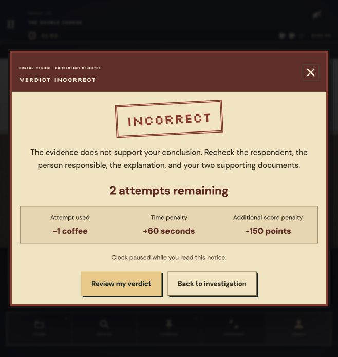

# Verdict review verification — 2026-11-14

Integrated teammate commits through `ca50a47` (new sprites and respondent verdicts).

- `npm test`: 179 tests pass, including structured claims and legacy verdict migration.
- `npm run build`: both case graphs validate, TypeScript passes, production bundle builds.
- Browser, tutorial: submitted a wrong verdict; the native feedback dialog shows **Verdict incorrect**, two attempts, −1 coffee, +60 seconds and −150 additional points.
- Clock remained at 01:50 while the feedback dialog stayed open.
- Returning to the verdict preserves selections, shows the previous-error banner, and disables an identical resubmission.
- A second changed wrong answer shows **1 attempt remaining**. The third shows **CASE FAILED / No attempts remaining**, a zero score and no case fee.
- At 375×812, the feedback dialog has no horizontal overflow and both action buttons remain visible.
- Browser, main case: three clue searches, two pinned records, NOT GUILTY / Kyle Denton / fake support site reaches **CASE SOLVED**, 961 points and a $350 fictional bureau fee.
- Browser console: no captured errors during these checks.
- New room sprites, calendar date, clock hands and monitor text were inspected in the running game.

The old toast was outside the native verdict dialog and therefore below the browser's top layer. Feedback now has its own native dialog; increasing a toast's z-index alone would not address the bug.

